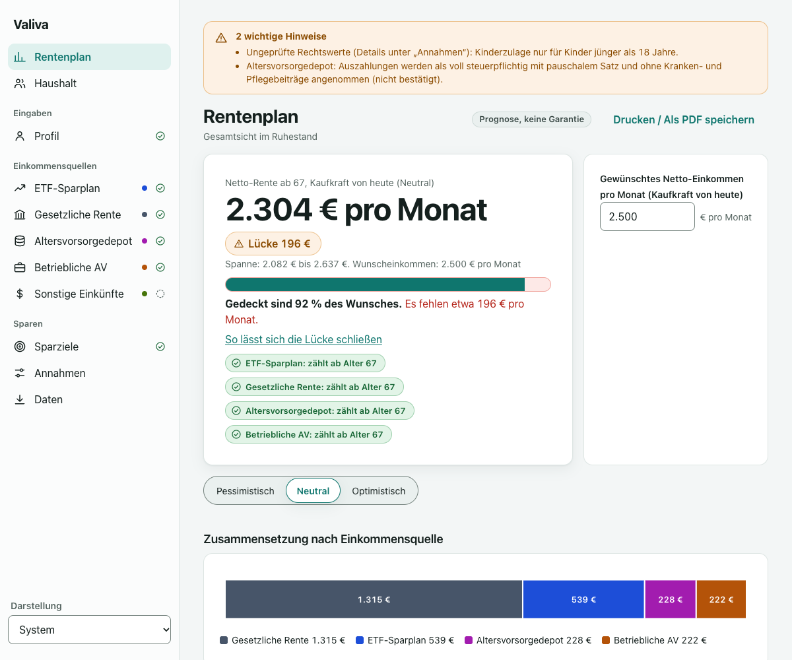
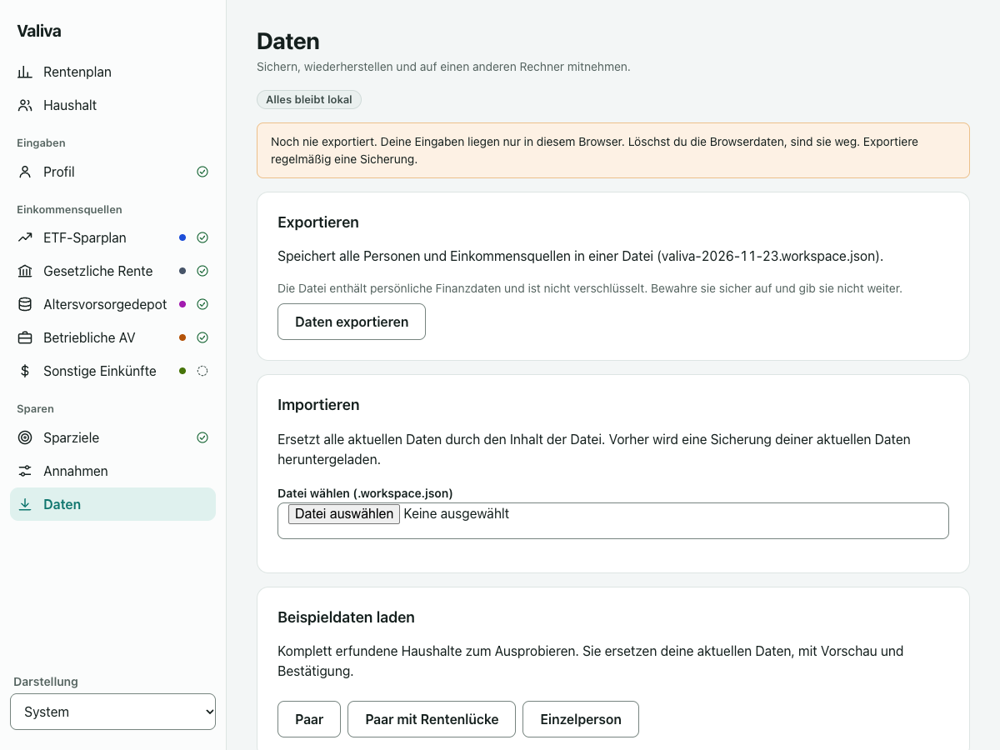

# Erste Schritte

Diese Seite führt dich in wenigen Minuten zu deinem ersten Ergebnis. Die App ist keine Anlage- und keine Steuerberatung, die Ergebnisse sind Prognosen und keine Garantie. Deine Eingaben bleiben in deinem Browser (mehr dazu in den [häufigen Fragen](faq.md)).

App öffnen: <https://antoniotroiano.github.io/valiva-app/>

## Erst ausprobieren

Auf der Startseite "Rentenplan" gibt es die Karte **Willkommen** mit dem Knopf **Mit Beispieldaten ausprobieren**. Damit lädst du einen erfundenen Haushalt und siehst sofort, wie fertige Ergebnisse aussehen. Auf der Seite "Daten" findest du fünf Beispiele (Einzelperson, Paar, Paar mit Rentenlücke, Rentnerin, Paar mit einer Person in Rente). Beim Laden ersetzen sie deine aktuellen Daten; die App fragt vorher nach und lädt eine Sicherung deiner bisherigen Daten herunter.

## Mit deinen Daten beginnen

Wähle **Mit meinen Daten beginnen**. Die Karte "Nächster Schritt" zeigt dir, was als Nächstes fehlt. In der Seitenleiste steht bei jeder Eingabeseite, ob sie noch leer oder ausgefüllt ist.

### 1. Profil prüfen

Auf der Seite **Profil** stehen Geburtsjahr, gewünschtes Rentenalter und Planungshorizont (bis zu welchem Alter gerechnet wird). Optional trägst du die Geburtsjahre deiner Kinder ein (für die Kinderzulage beim Altersvorsorgedepot) und dein **Wunscheinkommen im Ruhestand**: Wie viel Netto pro Monat möchtest du, in Kaufkraft von heute? Ohne dieses Wunscheinkommen kann die App keine Rentenlücke berechnen.

**Beziehst du schon Rente?** Schalte hier "Ich beziehe bereits Rente" ein und trage das Jahr des Rentenbeginns laut Rentenbescheid ein. Die Bausteinseiten fragen dann nach den tatsächlichen Werten aus Bescheiden und Kontoauszügen statt nach einer Prognose, und die App rechnet ab heute. Bei Paaren mit einer Person in Rente zeigt der Rentenplan, was heute schon ankommt; die Jahre, bis die andere Person in Rente geht, zählen nicht zur Lücke, weil ihr Gehalt nicht modelliert ist.

Darunter stehen Annahmen wie Inflation und die drei Renditeszenarien. Sie sind mit Standardwerten vorbelegt und gelten für alle Einkommensquellen. Die Werte sind Annahmen, keine Prognosen.

### 2. Einkommensquellen eintragen

In der Seitenleiste unter "Einkommensquellen" legst du an, woher dein Geld im Ruhestand kommt. Du musst nicht alle ausfüllen, nur das, was du hast.

- **Gesetzliche Rente:** Trage den Betrag aus deiner Renteninformation ein (dort unter "Regelaltersrente bei Beitragszahlung bis zur Altersgrenze") und das Jahr der Renteninformation. Die App rechnet Abschlag oder Zuschlag für deinen Rentenbeginn, Steuer sowie Kranken- und Pflegeversicherung ein.
- **ETF-Sparplan:** Startkapital, monatliche Sparrate, Laufzeit, Kosten (zum Beispiel Fondskosten) und die Rendite je Szenario. Du siehst drei Szenarien und kannst auch rückwärts rechnen: Welche Rate brauche ich für ein Zielvermögen?
- **Altersvorsorgedepot** und **Betriebliche AV:** Beiträge, Kosten und Auszahlung.
- **Sonstige Einkünfte:** bestehende Verträge und andere Einkünfte im Alter, zum Beispiel Riester-Rente, private Rente, Basisrente, Pension oder Miete. Hier gibst du einen bekannten Monatsbetrag ein; die App prognostiziert dafür kein Kapital.

Ungültige Eingaben meldet die App direkt am Feld und rechnet damit nicht weiter, statt ein falsches Ergebnis zu zeigen.

### 3. Rentenplan lesen

Der **Rentenplan** fasst alles zusammen:

- Die große Zahl ist dein **Netto-Einkommen im Ruhestand pro Monat** in Kaufkraft von heute, für das gewählte Szenario (pessimistisch, neutral, optimistisch).
- Hast du ein Wunscheinkommen eingetragen, siehst du **Lücke oder Überschuss** und wie viel Prozent des Wunsches gedeckt sind.
- Der Link **So lässt sich die Lücke schließen** zeigt, welche zusätzliche monatliche ETF-Rate die Lücke schließen würde.
- Unter "Mehr dazu" findest du den Verlauf je Alter, Was-wäre-wenn-Rechnungen und Tabellen.
- Gelbe Hinweise oben nennen wichtige Einschränkungen, zum Beispiel ungeprüfte Rechtswerte.

### 4. Haushalt (optional)

Auf der Seite **Haushalt** legst du weitere Personen an, zum Beispiel deinen Partner oder deine Partnerin. Jede Person hat eigene Einkommensquellen und Sparziele; das Wunscheinkommen gilt für den ganzen Haushalt. Bei genau zwei Personen kannst du die Hinterbliebenenrente berücksichtigen und angeben, ob ihr gemeinsam veranlagt werdet. Beides ist nie vorausgewählt. Mit dem Personenumschalter oben wechselst du zwischen den Personen und der Haushaltssicht.

### 5. Daten sichern

Deine Eingaben liegen nur in diesem Browser. Auf der Seite **Daten** speicherst du sie mit **Daten exportieren** als Datei (`valiva-JJJJ-MM-TT.workspace.json`). Mit dieser Datei kannst du sie später oder auf einem anderen Rechner wiederherstellen. Die Datei ist nicht verschlüsselt und enthält persönliche Finanzdaten, bewahre sie sicher auf.

Mach das nicht nur einmal: Löschst du die Browserdaten, sind deine Eingaben weg. Die App erinnert dich an eine Sicherung, solange du noch nie exportiert hast oder der letzte Export alt ist.

## Weiterlesen

- [So rechnet die App (Überblick)](how-it-works.md)
- [Häufige Fragen](faq.md)
